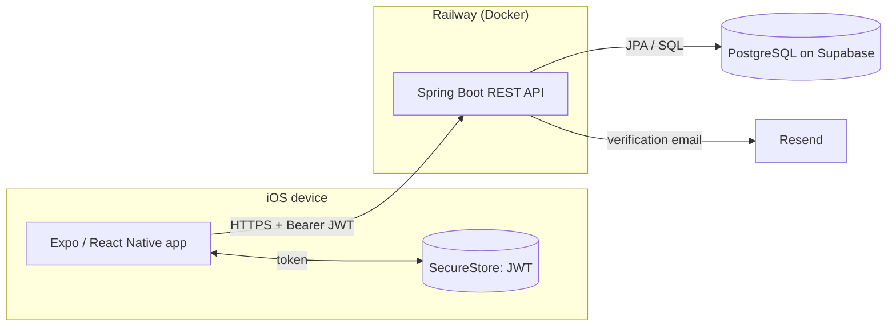

# Dishcision

A pantry-aware recipe app for people who can never decide what to eat: log what's in your kitchen, get recipes you can actually make, and cook them with the pantry updating itself.

**Live on the App Store:** [Make a Dishcision](https://apps.apple.com/us/app/make-a-dishcision/id6796202066)

## Demo

- App Store: https://apps.apple.com/us/app/make-a-dishcision/id6796202066
- Screenshots / GIF: <!-- TODO: add screenshots or a short screen recording -->

## Features

- **Accounts with email verification**: register, receive a 6-digit code by email, verify, then log in. Includes remember-me, change password, edit name and delete account.
- **Pantry tracking**: add, edit and delete ingredients with quantity, unit and expiry date; search and filter; expiry status (urgent / warn / fresh) with a configurable alert window.
- **Ingredient autofill**: search backed by a canonical ingredient database with aliases (e.g. different names for the same ingredient).
- **Recipe browsing and suggestions**: browse and search recipes; suggestions split into full and near matches against your pantry, filtered by your dietary preferences.
- **Save recipes**: swipe to save and view saved recipes.
- **Cook a recipe**: one tap deducts the right amounts from your pantry (soonest-expiring items first), warns on partial matches, and records the meal in your cooking history.
- **History and weekly stats**: cooked meals and a weekly summary, including an estimated money saved versus eating out.
- **Preferences**: diet tags, allergy tags, expiry alert days and text size.
- **Light / dark theme** and a first-run onboarding overlay.

## Tech stack

| Layer | Tech |
|---|---|
| Mobile app | React Native 0.81, Expo SDK 54, Expo Router, React Context, axios, expo-secure-store |
| Backend | Java 21, Spring Boot 4.0.5, Spring Security (stateless JWT, BCrypt), Spring Data JPA, Bean Validation, Lombok |
| Database | PostgreSQL, schema managed by Flyway migrations (hosted on Supabase) |
| Email | Resend HTTP API (verification codes) |
| Hosting / delivery | Railway (backend, Docker), EAS Build and the App Store (mobile) |
| Testing | JUnit 5, Mockito (Spring Boot test starters) |

## Architecture

The Expo app talks to a stateless Spring Boot REST API over HTTPS, authenticating each request with a JWT held in the device's secure store. The API follows a strict Controller → Service → Repository layering, returns DTOs only, and reads the user's identity from the token, never from request parameters. Data lives in Postgres, and verification emails go out through Resend.



## Getting started

### Prerequisites

- Java 21 (the Maven wrapper is included)
- Node.js and npm
- PostgreSQL (local) or a hosted Postgres such as Supabase
- A [Resend](https://resend.com) account and API key (for verification emails)
- Xcode / iOS Simulator or the Expo Go app to run the mobile client

### Environment variables

**Backend** (set in your shell, an untracked `backend/.env`, or your host's dashboard; never commit these):

| Variable | Purpose |
|---|---|
| `DB_URL` | JDBC URL, e.g. `jdbc:postgresql://localhost:5432/dishcision_db`. Defaults to that local URL if unset |
| `DB_USERNAME` / `DB_PASSWORD` | Database credentials |
| `JWT_SECRET` | HMAC signing secret, at least 32 bytes. Generate with `openssl rand -base64 48` |
| `RESEND_API_KEY` | Resend API key used to send verification emails |
| `GMAIL_USERNAME` / `GMAIL_APP_PASSWORD` | Referenced by a legacy Gmail SMTP block in `application.properties`; email is now sent through Resend, so any placeholder value is fine |
| `PORT` | Optional, defaults to `8080` (Railway sets this automatically) |
| `SPRING_PROFILES_ACTIVE` | Set to `prod` in production (disables SQL logging, enables Flyway baseline on an existing DB) |

**Frontend** (`frontend/.env`):

| Variable | Purpose |
|---|---|
| `EXPO_PUBLIC_API_URL` | Base URL of the backend, e.g. `http://<your-LAN-IP>:8080` for local development. Anything prefixed `EXPO_PUBLIC_` is bundled into the app, so never put secrets here |

### Resend email setup

1. Create a Resend account and an API key; set it as `RESEND_API_KEY`.
2. For real delivery, verify a sending domain in Resend and set the sender in `backend/src/main/resources/application.properties` (`resend.from`) to an address on that domain. Without a verified domain, Resend only delivers test emails to your own account address.
3. Register in the app: the 6-digit code arrives by email and expires after 10 minutes.

### Local setup

1. **Database.** Create an empty Postgres database and user:

   ```sql
   CREATE DATABASE dishcision_db;
   CREATE USER dishcision_user WITH PASSWORD 'choose-a-password';
   GRANT ALL PRIVILEGES ON DATABASE dishcision_db TO dishcision_user;
   \c dishcision_db
   GRANT ALL ON SCHEMA public TO dishcision_user;
   ```

   You don't create tables by hand: Flyway applies `backend/src/main/resources/db/migration/V1__init.sql` on first start, and the ingredient and recipe seeders populate reference data when those tables are empty.

2. **Backend.**

   ```bash
   cd backend
   export DB_USERNAME=dishcision_user DB_PASSWORD=... JWT_SECRET=... RESEND_API_KEY=... \
          GMAIL_USERNAME=unused GMAIL_APP_PASSWORD=unused
   ./mvnw spring-boot:run
   ```

   The API listens on `http://localhost:8080`. Hibernate runs in `validate` mode, so the schema comes only from Flyway migrations. Add new migrations as `V2__...sql`, never edit `V1`.

3. **Frontend.**

   ```bash
   cd frontend
   npm install
   echo "EXPO_PUBLIC_API_URL=http://<your-LAN-IP>:8080" > .env
   npx expo start --clear
   ```

   Then press `i` for the iOS simulator, or scan the QR code with Expo Go on a phone on the same network.

### Deploying

- **Database:** create a Supabase project and use its Postgres connection details for `DB_URL`, `DB_USERNAME` and `DB_PASSWORD`. On first boot against a non-empty database, `spring.flyway.baseline-on-migrate=true` (in `application-prod.properties`) lets Flyway adopt it instead of failing.
- **Backend:** Railway builds `backend/Dockerfile` (multi-stage Maven build to a JRE 21 image). Set the environment variables above in the Railway service and run with `SPRING_PROFILES_ACTIVE=prod`.
- **Mobile:** point `EXPO_PUBLIC_API_URL` at the Railway URL (done per build profile in `frontend/eas.json`), then build with `eas build --profile production` and submit with `eas submit`.

### Test

```bash
cd backend
./mvnw test -Dtest='UnitConversionServiceTest,IngredientMatchingServiceTest'   # unit tests, no database needed
./mvnw test                                                                    # full suite; BackendApplicationTests needs a reachable database and the env vars above
```

The two unit-test classes were run and pass. The full suite and the mobile app were not run as part of writing this README. There are no frontend tests yet.

## Engineering decisions

- **Canonical ingredient matching engine**: pantry items and recipe ingredients live in separate tables with free-text names, so "scallion" in a recipe may not equal "spring onion" in a pantry. Matching resolves in priority order: canonical ingredient ID, then alias, then case-insensitive name fallback, and returns an explicit status (`MATCHED`, `PARTIAL_MATCH`, `ASSUMED_AVAILABLE`, `NO_MATCH`). Trade-off: a seeded canonical database must be maintained, but suggestions and deductions become predictable and testable (`IngredientMatchingService`).
- **Unit groups and ingredient-specific conversion**: units are grouped (weight, volume, count) and only convert within a group. Cross-group conversions (e.g. a garlic head to cloves) come from known per-ingredient tables, and anything unresolvable is treated as "assumed available" with no deduction rather than guessing (`UnitConversionService`). Trade-off: occasionally conservative, but the pantry is never silently corrupted. Quantities use `BigDecimal` throughout.
- **Atomic, expiry-aware cooking**: cooking a recipe is a single transaction that scales by servings, deducts from the soonest-expiring matching items first, removes emptied items, and writes the history row, so a failure leaves the pantry untouched (`CookService`).
- **Verified accounts, stateless sessions**: registration is gated by an emailed code with expiry and an attempt cap; sessions are stateless JWTs so the API scales horizontally without server-side session storage (`AuthService`, `JwtFilter`).
- **Schema as code**: Flyway owns the schema and Hibernate only validates it, so local, staging and production databases cannot drift silently.

## Security

- Passwords are hashed with BCrypt; sessions use signed JWTs; all non-auth routes require a valid token.
- User identity always comes from the token, so users can only reach their own pantry, history and preferences.
- Secrets (database credentials, JWT secret, email API key) are injected through environment variables and never committed; `.env` files are git-ignored.
- On the device, the token is kept in the iOS Keychain via `expo-secure-store`; production traffic is HTTPS-only.
- Request bodies are validated with Bean Validation, and errors are returned as generic structured responses without stack traces.
- A design-level review of the auth flow, with planned hardening work, is in [`docs/security/threat-model-auth-flow.md`](docs/security/threat-model-auth-flow.md).

## What I learned / challenges

**Why I built this:** This was my first solo project building a mobile app from scratch. I've always struggled to decide what to eat, which gave me the idea for Dishcision as a solution.

**Hardest technical problem:** Implementing automatic pantry deduction after a recipe is marked as cooked. Ingredients and quantities can have different names or unit groups because the pantry and recipe data live in separate tables, which is why I designed the canonical ingredient matching engine.

**Biggest learning curve:** Taking the app from a local setup to a live production environment (hosted database, deployed backend, App Store release). The whole process was new to me.

## Roadmap

- Auth hardening from the threat model (rate limiting, stronger password validation, token revocation).
- Frontend test coverage.
- More recipes and ingredients, and additional features over time.

## Changelog

See [CHANGELOG.md](CHANGELOG.md).
