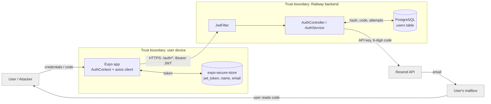

# Threat model: Auth flow (register, email verification, login, JWT session, account management)
Date: 2026-11-16 · Status: draft

## Scope & assumptions
- **In scope:** `/auth/*` endpoints (register, login, verify-email, resend-verification, password, name, delete), JWT issuance/validation, email verification via Resend, token storage on device (expo-secure-store), 401 handling.
- **Out of scope:** pantry/recipe business logic (only checked that they derive user identity from the JWT), Railway/Supabase platform hardening, Apple/Google store review.
- **Actors:** anonymous attacker on the internet, a registered user attacking another user, someone with physical access to a phone, a malicious app/network on the user's device.
- **Data:** email, display name, bcrypt password hash, 6-digit verification code, JWT. Low-to-medium sensitivity (no payments), but account takeover exposes personal pantry/diet/allergy data.
- **Deployment:** Spring Boot 4 on Railway (HTTPS URL), PostgreSQL, Resend for email, Expo/React Native client.

## Assets
| Asset | Why an attacker wants it |
|---|---|
| User accounts / sessions (JWT) | Account takeover, access to diet and allergy data |
| `JWT_SECRET` | Forge a token for any email, which means every account |
| Password hashes (`users.password`) | Offline cracking |
| Verification codes | Verify an email you don't own |
| Resend API key / sending domain | Send email as `app.makeadishcision.com`, phishing, spam |
| Availability of `/auth/*` | Lock real users out; run up email costs |

## Data flow

## Threats
Ranked highest first. L = likelihood, I = impact.

| # | STRIDE | Threat & scenario | L | I | Risk | Mitigation | Status | Location |
|---|---|---|---|---|---|---|---|---|
| 1 | D / S | **No rate limiting on any `/auth/**` endpoint.** Attacker scripts credential stuffing against `/auth/login` (bcrypt makes each guess slow, so it also burns CPU), or loops `/auth/resend-verification` for a victim or random emails to spam them and exhaust the Resend quota. | H | H | **High** | Per-IP and per-account throttling (e.g. Bucket4j or a Railway/Cloudflare edge rule), cooldown on resend, temporary lockout after N failed logins | Planned | `SecurityConfig.java:27` (`/auth/**` is `permitAll`, no limiter anywhere) |
| 2 | S | **Verification-code brute force via resend reset.** `resendVerification` sets attempts back to 0 and issues a new code, so an attacker gets 5 guesses per resend, repeated forever. 1,000,000 codes at 5 per cycle is about 200k cycles, trivial without a rate limit. A hit verifies an email they don't own, and `verifyEmail` returns a real JWT for that account. Practical risk: squatting/taking over a pre-registered unverified account. | M | H | **High** | Do not reset attempts on resend (or cap resends per hour); IP rate limit; invalidate the old code on resend (already true) | Partial: 5-attempt cap exists, but is bypassable | `AuthService.java:102`, `:140`, `:197-202` |
| 3 | S | **Pre-registration / email squatting.** Anyone can register `victim@x.com`. The account stays unverified, so the real user sees "Email is already in use" and is locked out of registering. There is no way to reclaim it except `resend-verification` followed by verify, which does work for the real owner, but the UX and the error message are confusing. | M | M | **Medium** | On register for an existing unverified email, re-issue a code instead of erroring; purge unverified accounts after N days | Planned | `AuthService.java:44-46` |
| 4 | I | **Account enumeration.** `login` returns `INVALID_CREDENTIALS` for an unknown email but `INCORRECT_PASSWORD` for a wrong password; `register` returns `EMAIL_IN_USE`; `resend-verification` and `verify-email` throw a plain `RuntimeException` for an unknown email (500 vs 4xx also differs). Attacker builds a list of registered emails, then targets them for phishing or stuffing. | H | M | **Medium** | Return one generic "Invalid email or password" for login; make resend always return 200; use the same response for unknown email in verify | Planned | `AuthService.java:75`, `:78`, `:97`, `:135` |
| 5 | S / E | **Weak JWT secret = total compromise.** `Keys.hmacShaKeyFor` needs at least 32 bytes for HS256, but a short or guessable `JWT_SECRET` env value is not checked at startup beyond that. Anyone who learns or brute-forces the secret can mint a token for any email. Secret is correctly env-injected and never committed (history shows blank placeholders only). | L | H | **Medium** | Generate with `openssl rand -base64 48`, store only in Railway env vars, rotate if ever exposed, add a startup length check | Partial: env-injected, not in git | `JwtUtil.java:14,22`; `application.properties:19` |
| 6 | S | **No token revocation / long-lived stateless JWT.** Tokens last 24h (`86400000` ms) and nothing invalidates them. After a password change, a stolen token keeps working until expiry. After account deletion, `UserDetailsService` throws `UsernameNotFoundException` inside `JwtFilter`, which is uncaught (see #7). Logout is client-side only. | M | M | **Medium** | Add a `tokenVersion` or `passwordChangedAt` claim checked in the filter; shorten access-token life and add a refresh token; bump version on password change/delete | Planned | `JwtUtil.java:26-33`, `JwtFilter.java:35-44`, `AuthService.java:156` |
| 7 | D / I | **Exceptions in `JwtFilter` bypass the global handler.** A valid token for a deleted user makes `loadUserByUsername` throw, which is outside `@RestControllerAdvice` and yields a 500 and a stack-trace log line instead of a clean 401. The client's 401 handler never fires, so the app can get stuck with a dead token. Also `extractEmail` is called after a separate `isTokenValid` parse (double parse, minor). | M | L | **Low-Med** | Wrap the lookup in try/catch and clear the context; add an `AuthenticationEntryPoint` that returns 401 JSON | Planned | `JwtFilter.java:36-37` |
| 8 | E | **Weak password policy and no validation on change.** Register requires only 8 chars (no breached-password or complexity check). `ChangePasswordRequest` has **no** `@Valid`/`@Size`, so `newPassword` can be empty or 1 char, and a null `currentPassword` may cause a 500. `updateName` takes a raw `Map`, so blank or very long names are accepted. | M | M | **Medium** | Add `@Valid` + `@Size(min=8)` on `ChangePasswordRequest`; validate name length; consider a breached-password list | Planned | `ChangePasswordRequest.java:7-10`; `AuthController.java:54,62` |
| 9 | I | **Verification code sits in the DB in plaintext and is compared with `equals`.** A DB read (SQL injection elsewhere, leaked backup) exposes live codes for 10 minutes. The compare is not constant-time (low practical risk over the network). | L | M | **Low-Med** | Store a hash of the code; use `MessageDigest.isEqual` | Planned | `User.java:33-34`; `AuthService.java:110` |
| 10 | I | **PII in logs.** The email service logs every recipient address at INFO, and Resend error bodies are logged. Railway logs are retained and visible to anyone with project access. No codes or tokens are logged (good). | M | L | **Low** | Mask emails in logs (`k***@gmail.com`); keep codes out of logs (already the case) | Partial | `EmailService.java:33,47,50` |
| 11 | T / I | **Token in transit and at rest on the client.** Production uses HTTPS (`eas.json`, `.env.production`), and the JWT is kept in `expo-secure-store` (Keychain/Keystore), which is good. But the dev fallback is plaintext `http://192.168.x.x`, and a misconfigured build without `EXPO_PUBLIC_API_URL` would ship credentials over HTTP. `remember_me=false` still writes the token to storage until the next cold start. | L | M | **Low-Med** | Fail the build if the API URL is not `https://` in production profiles; no fallback in release builds; enforce HSTS on the backend/edge | Partial | `client.js:6`; `authApi.js:42-45` |
| 12 | R | **No audit trail for security events.** No log of login success/failure, password change, account deletion, or verification. If a user claims "I didn't change my password" there is nothing to check, and credential stuffing (#1) would go unnoticed. | M | M | **Medium** | Log structured security events with user id, IP and timestamp (never secrets); alert on spikes of failed logins | Planned | `AuthService.java` (none today) |
| 13 | E | **Destructive account endpoint needs only a bearer token.** `DELETE /auth/delete` and `PUT /auth/password` rely solely on the JWT. A stolen token (XSS is not applicable on mobile, but device compromise or a leaked log is) can delete the account permanently, without re-entering the password. | L | M | **Low-Med** | Require current password (or a fresh re-auth) for account deletion | Planned | `AuthController.java:67-71` |
| 14 | T | **CSRF disabled and no CORS config.** Acceptable here: stateless bearer-token API consumed by a native app, no cookies. Only becomes a risk if a web client or cookie auth is added. | L | L | **Low** | Revisit if a web build (`app.json` has a `web` target) ships; add an explicit CORS allowlist then | Accepted | `SecurityConfig.java:23` |
| 15 | I | **Positive controls (verified).** Passwords use BCrypt; email is normalized to lowercase so duplicate accounts are blocked; unverified accounts cannot log in; user id for pantry/history/preferences comes from the JWT principal, not from request parameters, which prevents IDOR on those routes; the global handler hides stack traces behind a generic 500; `.env` files are git-ignored and secrets are env-injected. | - | - | - | n/a | Exists | `SecurityConfig.java:38`; `AuthService.java:50,192`; `GlobalExceptionHandler.java:42` |

## Accepted risks
- #14 CSRF/CORS: accepted while the client is native-only.
- 24h JWT lifetime without refresh tokens is acceptable for an MVP, provided #6's `tokenVersion` check is added.

## Open questions
1. Is `frontend/.env.production` meant to be committed? It only holds the public API URL, so it is fine, but confirm no secret is ever added to it (anything `EXPO_PUBLIC_*` ships inside the app bundle).
2. `application.properties` defines `resend.api.key` but `EmailService` reads `resend.api-key`. Confirm that production actually resolves it (via `RESEND_API_KEY` or a prod override); a silent mismatch would break verification emails and therefore all sign-ups. The `spring.mail.*` Gmail block also appears unused now.
3. Is there a "forgot password" flow planned? It would be the highest-risk addition (reset tokens, same enumeration and rate-limit concerns).
4. Is Railway putting a proxy or WAF in front of the service that could host the rate limits (#1)?

## Next steps
1. **Add rate limiting** to `/auth/login`, `/auth/register`, `/auth/verify-email`, `/auth/resend-verification` (per IP and per email), and stop resetting `verificationAttempts` on resend (threats #1, #2).
2. **Unify auth error responses** (generic login failure, silent resend, proper 4xx instead of `RuntimeException`) and make `JwtFilter` return 401 cleanly (threats #4, #7).
3. **Validate password changes** (`@Valid`, min length) and add a `tokenVersion` claim so password change or deletion invalidates old tokens (threats #8, #6).
